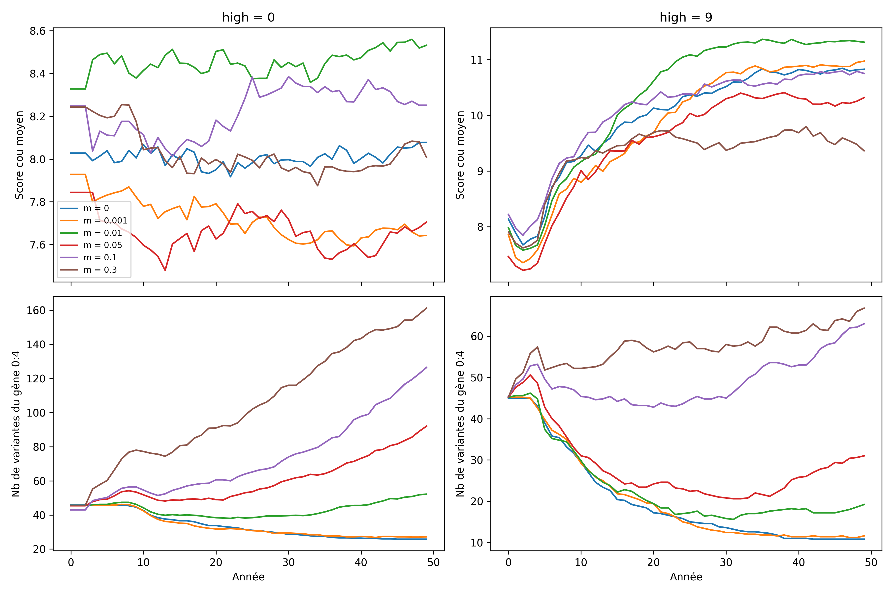

# Natural Selection Simulation

A Python simulation of natural selection in a population of giraffes.
It studies how **mutation rate** and **environmental pressure** interact
to shape the evolution of a trait (neck size).

Full write-up: [paper/Natural_Selection_and_Genetics.pdf](paper/Natural_Selection_and_Genetics.pdf)

## The model

- Each giraffe has a **DNA sequence of 8 bases** (A, T, G, C).
- The first 4 bases determine the **neck score**, the last 4 the **lifespan**.
- Each base has a value in a scoring table (a deliberate simplification).
- Reproduction: two parents of opposite sex, DNA copied with random
  mutations (`m_prob`), one gene randomly inherited from each parent.
- Environment: trees of height `high`. A giraffe whose neck score is
  below `high` is hungry and ages twice as fast.

## Main results

| Experiment | Finding |
|---|---|
| Neck size (high = 9) | Mean neck score rises over generations: natural selection |
| Mutation rate | Without mutations, no adaptation; the highest rate is not the best |
| high = 0 vs high = 9 | No selection pressure at high = 0; at high = 9, high mutation rates maintain diversity but slow adaptation |



## Run it

```bash
git clone https://github.com/ambroise-lb/natural-selection-simulation.git
cd natural-selection-simulation
pip install -r requirements.txt
python simulation.py
```

## Limitations

Only 8 bases, simplified DNA-to-trait mapping, no real protein synthesis.
It illustrates the principles of evolution, not its full biological complexity.

## Possible extensions

- Longer genomes, more traits
- Recombination / crossing-over
- A changing environment over time
